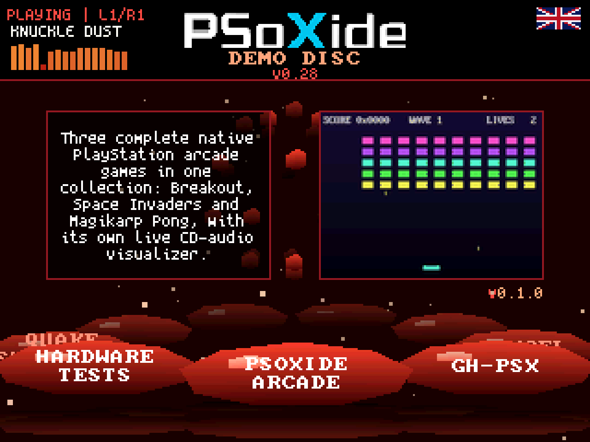
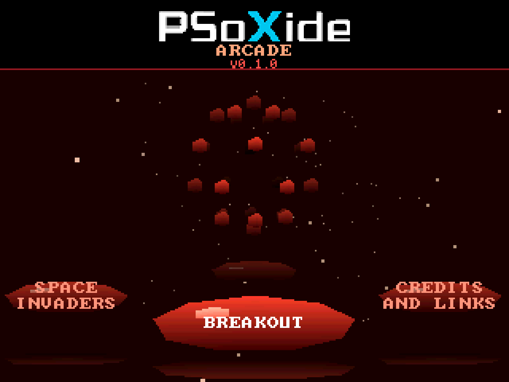
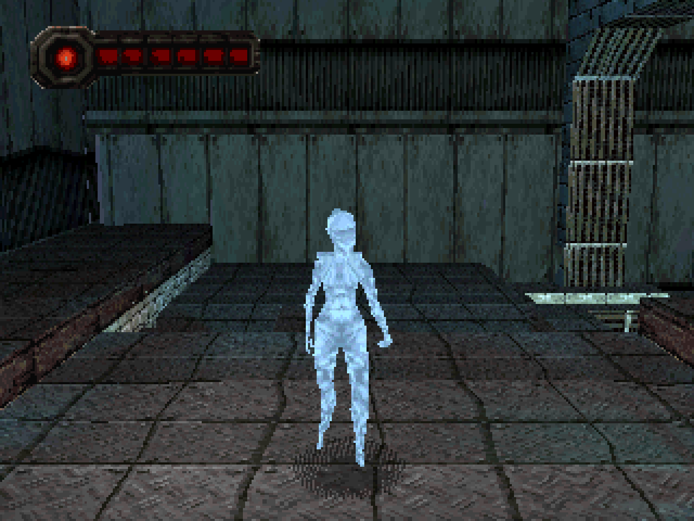

# PSoXide demo disc

**[Download the latest version on itch.io](https://bonnie-studios.itch.io/psoxide-demo-disc)**, or [play it in your browser](https://bonnie-studios.itch.io/psoxide).

> **Largely written with agentic coding.** I direct the agents and test their work in two places: PSoXide's emulator, which profiles every cycle, and a real PlayStation, which shows me where the emulator is wrong. Working between them is where the accuracy and the speed come from. [How PSoXide is built](https://ebonura.github.io/PSoXide/how-its-built/)

One CD-R that boots on a real PlayStation into a menu, and chain-loads any of
the PSoXide programs burned alongside it.

| Demo Disc outer carousel | PSoXide Arcade selector |
| --- | --- |
| [](assets/readme/v028-carousel.png) | [](assets/readme/arcade-selector.png) |

| Current Cortex Ignition project |
| --- |
| [](assets/readme/cortex-current.png) |

```bash
make disc      # -> "PSoXide Demo Disc.{bin,cue}" in the PSoXide game library
make check     # host tests, including the Quake pin check
```

## Public release

**v0.45** requires an analog DualShock, lets the left stick drive the
carousel, moves PSXcel to the end of the carousel and carries the newest build of
every program from its repository's main. See [the changelog](CHANGELOG.md).

The public disc includes Quake 1.06 shareware and excludes Half-Life.
Every deployment updates both the BIN/CUE download and the playable browser
disc. Stage them from the same tested image:

```sh
disc-tools deploy-public \
  --cue "/path/to/PSoXide Demo Disc v0.45.cue" --version v0.45 \
  --emulator ../PSoXide-emulator --out /path/to/new-release --publish
```

This builds the browser emulator with Trunk, verifies the public game and audio
layout, and proves the streamed audio/data reconstruct the original image.
The public disc has no CD-DA track (`deploy-public` refuses one). It ships as
a compact index (`demo-disc.pxi`) and a payload (`demo-disc.pxw`) of deflated 32-sector chunks,
which the page reads lazily over HTTP Range requests and caches in IndexedDB. Sync, header, EDC and ECC are
rebuilt on read; `deploy-public` builds the packer (`webdisc`, crate `psx-webdisc`) from the emulator checkout
at the `web_player` pin and the packer reads its files back and compares every sector with the image.
A payload that reaches itch.io's 200 MB file limit is split into `demo-disc.pxw.001`, `.002`, ... (the 0.48
disc packs to 178 MiB, one file). The pin in `release-components.json` must be an emulator that has `psx-webdisc`.
Omit `--publish` to prepare packages for review. `make itch` only updates the
download; the older `make release-web` only stages GitHub delivery assets.
Neither is a complete deployment on its own.

After upload, check both live pages: launch Cortex from the browser carousel,
check music and input, and confirm the downloadable version. Keep the existing
page colours unless a change is requested. Update both pages' player-facing
changelogs when gameplay changes ship.

The two itch.io pages are the only destinations. The private editions (anything
built with `HL=1`, `CS=1`, `HK=1` or the lineup flags that add WipEout and the
hardware tests) are for local hardware verification only. They are never
uploaded, shared on request or handed to anyone, and never go into either
public package.

The current public destinations are
[itch.io](https://bonnie-studios.itch.io/psoxide-demo-disc) and the
[browser emulator](https://bonnie-studios.itch.io/psoxide).

## Releasing to itch

One command takes a pressed Public disc to both itch.io pages, the playable
build (`bonnie-studios/psoxide:html5`) and the download
(`bonnie-studios/psoxide-demo-disc:psx`):

```sh
./release-public.sh --version v0.48 \
  --cue "$HOME/Downloads/ps1 games/PSoXide Demo Disc v0.48.cue" --dry-run
```

Drop `--dry-run` for the real thing. It runs `disc-tools release`, which, in order:

1. refuses unless this repository is clean, on `main` and level with `origin/main`;
2. clones the emulator fresh and checks out the `web_player` pin of
   `release-components.json`;
3. reuses the Public disc (`--cue`), or presses it with `--lineup <json> --frontend <frontend>`;
4. runs `deploy-public` into an empty `build/release-<version>/out` (`--work` moves it),
   without `--publish`;
5. runs `public-only` on the web and download folders together, then `webdisc verify`
   of the compact payload against the download BIN;
6. runs the browser journey suite of the pinned emulator (`tools/web-journeys/run.mjs`,
   Node and Chrome) against the web folder (`--chrome` names another Chrome);
7. prints a summary, then waits for you to type the version. Anything else cancels.
   It re-hashes both folders so nothing changed since the checks, runs `butler push
   ... --userversion <version>` for both channels and `butler status` for both.

`--dry-run` stops before step 7 and prints the exact butler commands instead; it also
downgrades the repository-state refusals of step 1 to warnings so a branch can rehearse
a release. `--emulator-source` clones the emulator from another URL or path. `butler`
must be installed and logged in. The private editions are never released this way:
`public-only` fails on them.

## How it boots

The BIOS reads `SYSTEM.CNF`, loads `PSX.EXE` (the launcher), and runs it. The
launcher reads `DEMOTOC.BIN` at a fixed LBA to find out what is on the disc,
draws the menu, and on selection streams the chosen program off the disc and
jumps to it.

That last step needs one trick. Every PSoXide program links to `0x80010000`
(`sdk/psoxide.ld`), including the launcher, so the launcher cannot load a game
itself: it would overwrite its own code halfway through the copy. The `loader`
crate is therefore built separately, linked at `0x801C8000`, and embedded in
the launcher as raw bytes. The launcher copies it there, flushes the
instruction cache, and jumps. The blob and the stack are the only RAM it keeps;
the game can land anywhere else, above the blob as well as below it (the
Half-Life intro loads near the top of RAM, because it has to sit above the
game it goes on to load).

The addresses live in `chainload-layout/`, the one place the loader's linker
script, the launcher and `mkdisc` read them from. `mkdisc` refuses to build a
disc containing a program whose payload, rounded up to whole sectors, would
overlap the blob or the stack, and prints every program's extent and its
margin, so that constraint fails the build rather than the console. The loader
applies the same rule (`psx_chainloader::check_payload`) before it reads a
sector.

## Layout

| Piece | What it is |
| --- | --- |
| `loader/` | the chain-load blob, its own linker script, no `psx-rt` |
| `launcher/` | the menu, a normal PSoXide program |
| `games/PSoXide-editor/engine/crates/psx-carousel/` | shared ring and decorative geometry, host-testable |
| `games/PSoXide-editor/engine/crates/psx-disc-toc/` | shared PSXDEMO1 table format, used by `mkdisc` and the launcher |
| `tools/mkdisc/` | host disc builder, on top of PSoXide's `psx-iso` |
| `games/` | the source repos, as submodules |

## Sharing a disc

A program built for its own disc has that disc's geometry baked in: pack LBAs
cooked at 1024, CD-DA tracks numbered from 2. `mkdisc` does not re-cook
anything. It drops each game's *existing* disc image onto the big one verbatim
and records two numbers: how far the image moved, and how many CD-DA tracks sit
ahead of it. The loader passes those to the game's `_start`, and
`psx_io::disc_base` applies them inside the three places the SDK addresses the
disc. Both default to zero, so the same binary boots standalone unchanged.

Relocated sectors get their BCD MSF header rewritten so the drive's seeks land.
That is safe in place: Mode 2 Form 1 ECC is computed with those bytes zeroed.

## What is on it

The current layout has seven outer programs plus Credits on the standard
pressing; Half-Life, Counter-Strike and Hollow Knight are opt-in additions. PSoXide Arcade contains three games
of its own, and Celeste Collection contains both Celeste Classic games.
Every disc has one data track and no CD-DA. The menu music is XA inside the
launcher's own ISO (`MUSIC1.XA`, `MUSIC2.XA`, six songs) and each program that
has music carries its own XA files inside its image (interim design: a song
shared by two programs is stored twice until the shared pool described in
`xa-migration/PLAN.md` lands). Disc size and image hashes are recorded in each
build's receipts rather than fixed here. Automated evidence is recorded per
program and is not an original-hardware claim. See [the dated split
validation](docs/repository-split-validation-2026-09-05.md).

| Program | How it ships |
| --- | --- |
| Cortex Ignition | the Graybox Reach project as a whole image, two songs as XA after UI.PAK (the default 0.4b project does not link on editor main yet, so Graybox Reach holds this slot) |
| Half-Life | whole image, music as XA, `HL=1` only |
| Counter-Strike (cs-psx) | whole image, no music, `CS=1` only |
| Hollow Knight (hk-psx) | whole image, music as XA, `HK=1` only |
| Voxide | whole image, WORLD.PAK assets and four XA music pieces |
| NitroXide | whole image, WORLD.PAK arena atlas and six XA songs |
| Celeste Classic Collection | bare EXE |
| PSXcel | bare EXE |
| PSoXide Arcade | whole collection image: Breakout, Space Invaders and Magikarp Pong; Goncharov as XA |
| Quake shareware | whole image, eight ambient loops as XA |

Celeste and PSXcel never read the disc after boot, so they ride as bare EXEs
and do not care which SDK built them: a `_start` that ignores the loader's
arguments is still a correct `_start`. Voxide and NitroXide load `WORLD.PAK`
at startup, so their complete images ride the same relocation path as the
larger streaming games.

`CORTEX IGNITION` is the active new-engine entry. It comes from the exact
`editor/projects/default` project (formerly `cortex-ignition-tech-demo-0.4b`,
renamed when it became the editor's New Project template) at the exact editor
revision recorded in `release-components.json` and the Makefile. Both editions
expose this early tech demo directly on the shelf. `QUAKE SHAREWARE` is a
default program rather than a variant. Quake streams `WORLD.PAK`,
so a bare executable is not sufficient; the entry uses the same caller-provided
LBA offset that relocates
Voxide, NitroXide, and the other streaming programs. Its payload is pinned by
revision and by four artifact hashes, and `disc-only` refuses to lay out a
sector until they check. See [the Quake runbook](docs/quake-shareware.md).

The standard order is PSoXide Arcade, Celeste Collection, NitroXide,
Voxide, Quake Shareware, Cortex Ignition, then PSXcel; the credits are a
screen of their own, opened with Select. PSoXide
Arcade opens a dedicated cabinet selector for Breakout, Space Invaders and
Magikarp Pong. The optional programs sit between Voxide and Quake Shareware in
HK, CS, HL order.
The order lives in the Makefile's `MKDISC_ARGS`, which the public and the
private lineup pressings both lay out; `tools/disc-tools/tests/carousel_order.rs`
fails if PSXcel stops being last or a private lineup in `release/` lists its
programs in another order.

## Menu music

Music: Mulula VGM Loops, Ambient Jungle Vol 1, Vol 2 and Ambient Jungle D&B
Vol 3, CC BY 4.0, <https://mululavgmloops.itch.io/>. The loops are chained
into six pieces (JUNGLE 1 A and B, JUNGLE 2 A and B, JUNGLE DNB A and B). The
credit is on the launcher's credits screen (Select), in `audio/README.md`, the CHANGELOG and the release notes.

The pieces are packed with the SDK's `psx-audio-cook xa-pack` (37.8 kHz stereo,
two files, 35,100 sectors) and ride in the launcher's ISO. The launcher finds
`MUSIC1.XA` and `MUSIC2.XA` in the root directory, plays them with
`psx_io::cd::xa::Player`, and stops the song before it loads a program, since
a song is a read in progress. Authoring again (only when the songs change):

```sh
make music MUSIC_WAVS="a.wav b.wav ..." XA_COOK=/path/to/psx-audio-cook
```

`XA_COOK` needs a `psx-audio-cook` that has `xa-pack`; that is SDK branch
`feat/shared-xa-encoder-2026-10-15` until it reaches main, and it is not in
the pinned SDK. The command writes `audio/launcher/` (the XA files, the song
table `songs.rs` that the launcher compiles in, and `menu.spectrum`); commit
those. The song order of `MUSIC_WAVS` is the song numbering of the table, the
titles in the Makefile and the spectrum file.

No program on the disc borrows the menu songs by CD-DA track number any more.
The old convention (the menu songs are CD-DA tracks 2 to 5) is gone from
`mkdisc`; builds of Quake and NitroXide from before that carry the convention
and find fewer than five CD-DA tracks, which they treat as no music.

## The menu

The Shelf: the programs as jewel cases standing on a floor, one in focus, in
the look of the PSoXide home shell at 320x240 (near-black blue-grey, a soft
teal glow, white type, one cyan accent). The focused case lifts, brightens
inside corner brackets and sways on its hinge; its neighbours recede in scale
and light and lean toward it. Under the row sit the program's name with its
own version beside it, its description in English or Italian, and the start
button. The cover on each case is a picture baked into the launcher by
`tools/menu-art` from `assets/shots` (a program the launcher has no picture
for gets a plain cover and still starts).

| Control | Does |
|---|---|
| Left, right (d-pad or left stick) | browse the shelf |
| Cross or Start | start the program |
| Triangle | switch the descriptions and hints between English and Italian |
| Select | open the credits screen (Circle or Select to leave) |
| L1, R1 | skip through the six songs and the MUSIC OFF slot |
| L2 + R2 | the CD debug overlay (song state, drive head, refusals), for console photos |

The header carries the wordmark, the disc's name and version (the build's
`DISC_VERSION`), the Language key beside the EN/IT switch, and a level meter;
the song's name sits under it at the right. The six songs play as a shuffled
playlist, none twice until all have played. The meter is not keeping time, it
is listening: `mkdisc analyse` runs an FFT over each song when the music is
authored and the result ships in a `SPECTRUM.BIN` region the launcher reads at
boot, indexed by song time from the XA player (eight bars, each the mean of two
of the sixteen analysed bands).

Everything the menu shows about a program (name, version, descriptions, its
order) and about the music (titles, the credit line, the analysis) comes off the
disc's table, so one launcher serves every pressing. The only build-time choice
inside the launcher is the `private` cargo feature, which compiles in the covers
and names of the bring-your-own-assets programs; the Makefile turns it on for any
pressing that carries one, and a Public launcher holds neither. Which programs a
pressing has is decided when the disc is built, and nothing can be revealed at
run time.

The credits screen has the music attribution (author, works, licence, link),
the project links behind their platform marks, and the QR code for the link hub.
After 20 seconds without a button the text and hints fade out, the shelf drifts
and the music credit takes the footer's place; any button brings everything back
at once (`launcher/src/attract.rs` is all of that state).

The disc is meant for a DualShock in analog mode. The launcher locks port 1
there at boot and asks again every second; until it holds one, the menu shows a
notice in English and Italian and ignores the buttons.

Choosing a program is an event: the case comes to the middle of the stage, its
cover swings open on the left hinge like a real jewel case, the disc lifts out
of the tray and spins up into a flash (96 frames, `launcher/src/launch.rs`).
From the first of those frames the launcher stops the song and sends the drive's
head to the program's first sector, so the long seek out of the music file
happens during the animation (`launcher/src/chain.rs`). The loader then keeps a
standalone copy of the spinning globe and starfield, in the menu's colours,
visible over the progress bar while the selected program overwrites the launcher.

The menu's geometry and easing use no floating point and no 64-bit integers.
The case's picture, frame, brackets and glare all go through one GTE transform,
so a tilted case stays one object.

## Status

The combined-disc structural and Quake gates are verified headlessly. The
Quake gate uses the frontend's embedded-playtest path: the first executable
boot is HLE, while the launcher still reads the pressed table and chain-loads
the relocated guest from the built `.cue`. This is emulator evidence, not a
real-BIOS or original-console claim:

- the standard shelf holds seven programs including Cortex Ignition
- `hello-pack` streams its pack and reports ALL PASS with its image relocated
  220 sectors in, and still reports ALL PASS standalone (`make relocation-check`)
- two CD-DA discs on one image play 440 Hz and 1000 Hz respectively, so the
  second one's track base shifted it off track 2
- PSoXide Arcade owns the Goncharov song by
  [magikAAAAArp](https://www.youtube.com/@magikAAAAArp/videos), used with the
  band's permission; it is `MUSIC1.XA` inside the Arcade image and Magikarp
  Pong finds it through the relocated ISO

## Building

Install Rust through rustup, Make, Git, an authenticated GitHub CLI, Python 3
(for the editor and emulator repositories' own `bootstrap-components.py`,
which `make components` runs),
host C/C++ build tools, and `mipsel-none-elf-objdump` on `PATH`. The release
tools also call `rsvg-convert` (link icons), `flac` (browser delivery),
`trunk` and `butler` (public deploys) when those steps are run. Native frontend
builds on Ubuntu also need `pkg-config libasound2-dev libudev-dev
libxkbcommon-dev`; headless renderer checks need a working GPU backend, such
as Mesa Vulkan. Private repository/submodule access is required.

```sh
git clone --recurse-submodules https://github.com/EBonura/PSoXide-demo-disc.git
cd PSoXide-demo-disc
make components
make release-frontend
```

The host tools (receipts, release checks, menu-image cooking, the label and
its QR codes) are one Rust crate, `tools/disc-tools`. `make disc-tools` builds
it; the examples in this file call the binary as `disc-tools`, which is
`tools/disc-tools/target/release/disc-tools`, and `disc-tools help` lists its
subcommands. `make check` runs its tests.
Before `make disc`, provide the validated Quake source/artifacts described
below and the authorized audio inputs in [audio/README.md](audio/README.md).
The HL edition additionally needs a local Half-Life installation, found by
its builder or supplied through `HL_DIR`. `CS=1` needs the Windows Steam
Half-Life folder holding `valve/` and `cstrike/` (`CS_HALF_LIFE`, CrossOver's
Steam by default) and `HK=1` the Windows Hollow Knight install (`HK_GAME_DIR`).

`release-components.json` locks the SDK, editor/engine/Cortex and standalone
emulator separately. Their source receipts are checked before building.
The launcher and loader consume the SDK through the receipt-verified editor
hydration, so their shared engine collection crates and direct SDK dependencies
resolve one physical source path. `make components` checks that the editor SDK
revision equals the authoritative SDK pin before building. The host disc packer
uses the same engine-owned catalog format and a separate SDK ISO dependency;
its Cargo graph does not link the guest renderer. Games and Quake use the same
locked SDK/engine tuple. Carousel geometry and the PSXDEMO1 wire format have one
engine owner, shared with Arcade; the format and layout constants are unchanged.

Each pressing receives a `.components.json` receipt containing all game
revisions, nested component locks, the emulator hash and the final image hashes.
The existing Quake and HL release receipts remain additional verification.
See [the repository map](docs/repositories.md) for ownership and dependencies.


`make disc` writes into PSoXide's game library, so the disc shows up in the
emulator next to everything else. The release files are flat in that directory:

```
~/Downloads/ps1 games/PSoXide Demo Disc.{bin,cue}
```

Override with `DIST=...` for somewhere else, or `PSOXIDE_LIB=...` for a
different library. `PROGRAMS_PSOXIDE=/absolute/path/to/PSoXide-editor` selects the
checkout used for every ordinary rebuilt program. `PSOXIDE` remains the exact
checkout named by Quake's artifact provenance, so advancing the shared runtime
cannot silently change the SDK contract of the pinned Quake image. The Cortex
project is staged from `games/PSoXide-editor` under `build/`, keeping
generated output outside the pinned PSoXide worktree. `games/psoxide-arcade`
is the private collection repository
and the canonical owner of the Goncharov song (`goncharov.cdda` in history) by
[magikAAAAArp](https://www.youtube.com/@magikAAAAArp/videos), used with the
band's permission.

Two pressings exist. `make disc` builds the default one; `make disc HL=1`
builds the same disc plus Half-Life, for local hardware verification only,
under a different name so the two bins cannot be confused. That edition is
never distributed. Both carry Quake shareware. The
private submodules require repository access: a recursive clone fetches all
submodules, including HL-PSX, even when the standard edition is selected.
`HL=1` also requires the separately supplied original game data. Public
release targets reject that edition.

`CS=1` (Counter-Strike 1.6, from `games/cs-psx`) and `HK=1` (Hollow Knight,
from `games/hk-psx`) are opt-in the same way, independent of `HL=1` and of each
other. Each adds its carousel entry and its whole image; the disc name gains a
tag per flag (`PSoXide Demo Disc HL CS`, for example), the release receipt and
`make release-headless-check` cover exactly the programs pressed, and the
public release targets reject every such pressing. Only cooked outputs are
laid out; no game content enters this repository. mkdisc adds up every sector
before writing and fails with each program's share when a combination is
over `DISC_MAX_SECTORS` (an 80-minute CD-R by default). `make disc-budget`
prints that table for already built inputs without writing an image.

`make disc` needs the pinned Quake tree beside this one (`QUAKE_SRC`, the
sibling `quake-psx-pinned` checkout by default) and will not build without
it. `make quake-headless-check` is the gate to run before a burn: it chain-
loads Quake off the built disc twice and requires the two replays to agree.

## Pressing from a lineup

`make disc` rebuilds every program from the submodule pins. The v0.40 Half-Life
pressing instead takes each program exactly as it was built and played for the
PS1 games library, listed in `release/lineup-v0.40.json` with its sha256,
source revision and build receipt:

```sh
make lineup-disc LINEUP=release/lineup-v0.40.json HL=1 CS=1 HK=1 \
     DIST=<out dir> FRONTEND=<frontend>
```

The Makefile cannot take a path with spaces in a prerequisite, so from a
checkout under "Application Support" run it through a space-free symlink and
pass `ROOT=<symlink>`. The disc is named `PSoXide Demo Disc HL <git describe>`,
so commit and tag first; a dirty tree names the disc `...-dirty`. The public
pressing comes from the same lineup without `HL=1 CS=1 HK=1`: it is named
`PSoXide Demo Disc <git describe>` and its receipt leaves the optional programs
out.

When a game gets a new build, the re-run is:

1. Edit that game's row in the lineup file: the new `cue` (or derived source),
   `cue_sha256`, `bin_sha256`, `version`, `source.revision`/`ref`, `build` and
   `receipt`. Nothing else in the repo changes for a game-only update. Half-Life,
   Counter-Strike, Hollow Knight, Quake, Cortex, VoXide and the Arcade are
   whole images taken as they are. Celeste and PSXcel ride as their image's
   boot EXE, and NitroXide is sliced to its data track.
   An input whose library build has since moved on can be lifted back out of
   the previous pressing with `from_disc` (see `disc-tools lineup`).
2. `make lineup-budget ...` with the same arguments: it verifies the lineup and
   prints the sector table without writing an image.
3. Commit, tag, `make lineup-disc ...`. The release and component receipts are
   written beside the image; `disc-tools lineup receipt` fails if any pressed entry
   differs from its lineup input.
4. `disc-tools chainloads --frontend F --cue C` (Cortex,
   Quake, Half-Life, Counter-Strike and Hollow Knight, each
   replayed twice and required byte-identical) and
   `disc-tools programs --frontend F --cue C --out D` (the rest), then
   look at a launch frame of every game.
5. `disc-tools celeste-nav --frontend F --cue C --out D`
   checks both Celeste games after launch from the actual pressing. It covers
   pause-menu quits and Select+Start with digital and analog pads, credits
   entry and Cross exit, then longer analog routes with held buttons and three
   successive game entries. The output directory must be
   new; it retains disc and emulator hashes, route commands, logs and frames.
   `--suite basic` selects the eight short routes and `--suite stress` the two
   longer ones. `--suite save` tests both analog carts after changing SFX
   volume in the pause menu, requires the changed setting in a fresh memory
   card file, then checks menu and credits navigation. All twelve routes run
   by default. A passing route confirms those emulated inputs only; it does
   not resolve a console-only controller failure.

6. `disc-tools audio-relocation --cue C --input NAME=CUE ...`
   (one `--input` per program that carries CD-DA, `--no-audio NAME` for the
   bare games) hashes every program track in the pressing against the cues
   they came from. The order of the programs' tracks
   is read from the disc table, so a reordered carousel needs no edit.

`disc-tools quake headless` still holds frame pins keyed by carousel size,
but its route (two RIGHT presses) assumes Quake sits just before CREDITS, which
has not been true since Quake moved to card two; no Makefile target runs it.

## Repinning Quake

Six values in the Makefile and one submodule pointer are the whole Quake
contract. They all come out of a built Quake tree, and `make quake-repin`
measures them:

```bash
make quake-repin                          # from the default QUAKE_SRC
make quake-repin QUAKE_SRC=/path/to/tree  # from somewhere else
```

It prints, and writes nothing:

```
QUAKE_EXPECTED_REV ?= <the Quake tree's HEAD>
QUAKE_EXPECTED_PSOXIDE_REV ?= <the PSOXIDE_REV that tree declares>
QUAKE_EXPECTED_PROVENANCE_SHA256 ?= <dist/quake-psx.provenance.json>
QUAKE_EXPECTED_CUE_SHA256 ?= <dist/quake-psx.cue>
QUAKE_EXPECTED_BIN_SHA256 ?= <dist/quake-psx.bin>
QUAKE_EXPECTED_EXE_SHA256 ?= <dist/quake-psx.exe>
```

Paste those six lines over the ones near the top of the `Makefile`, then:

1. `git -C games/PSoXide-editor checkout <QUAKE_EXPECTED_PSOXIDE_REV> && git add
   games/PSoXide-editor` -- the Quake tree names the editor/engine revision it was built against, and
   the disc has to be on that same revision or `quake-verify` refuses.
2. Update `games/PSoXide-editor` and `PROGRAMS_EXPECTED_PSOXIDE_REV` together
   when the ordinary programs advance. The verifier requires that clean exact
   checkout and its build stamp. Keep `release-components.json` and all game
   component locks on the same SDK/emulator/editor tuple.
3. `make disc` -- rebuilds every ordinary program against the shared runtime,
   re-verifies the component inputs and the Quake image, and writes the provenance
   receipt beside the image.
4. `make quake-headless-check` -- the shared release checker locates Quake
   by name in the pressed carousel, verifies its executable checksum and
   runtime reads, and requires two identical successful chain-load replays.
   It does not require hand-updating a screenshot hash when the layout changes.

Nothing rewrites a pin on your behalf. A repin that edited its own contract
would be a verifier that agrees with whatever it is handed, and the diff is
what tells a reviewer which contract moved.

The Quake input also requires its schema-1 shipping sidecar, which binds the
clean Quake and PSoXide revisions, canonical shareware PAK, guest recipe and
toolchain, and actual cue/bin/EXE bytes. See
[the Quake runbook](docs/quake-shareware.md).

## Recent changes

Source snapshot **2026.09.05**: Documented the SDK, engine/editor, emulator and game revision pins used by the disc.
See the [changelog](CHANGELOG.md) for the remaining changes and published download versions.
